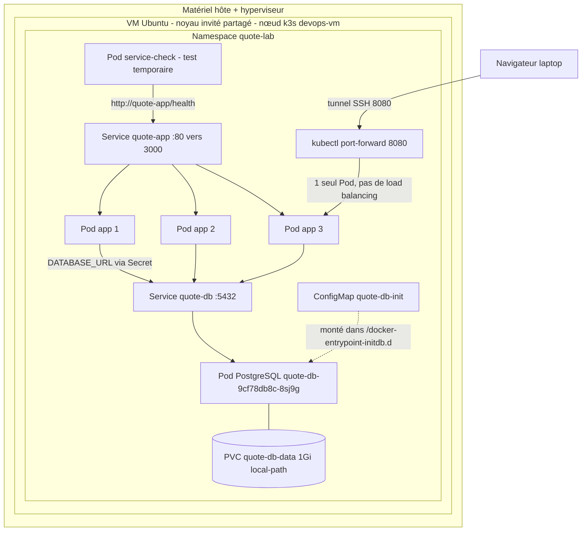

# Architecture notes – Lab 52

Branche : `main` · Namespace : `quote-lab` · Cluster : k3s sur la VM Ubuntu du cours (nœud `devops-vm`)

## 1. Résultats Lab 42

Résultats du cœur du Lab 42 (health, 3 replicas, remplacement de Pod, panne et reprise de la readiness) : voir [`../42-kubernetes/verification.md`](../42-kubernetes/verification.md).

## 2. Vérification de la base de données

| Vérification | Résultat |
|---|---|
| PVC `quote-db-data` | `Bound`, 1Gi, `ReadWriteOnce`, StorageClass `local-path` |
| Pod PostgreSQL | `1/1 Running` (readiness `pg_isready` OK) |
| Table `quotes` | présente (`\dt` : `public.quotes`, propriétaire `quote`) |
| Secret | `quote-db-secret` référencé dans les manifests, jamais commité |
| Application | `DATABASE_URL` injectée depuis le Secret (`secretKeyRef`), 3 replicas `1/1` |

### Persistance après remplacement du Pod de base

- Marqueur inséré via l'application : `res509-1794913067`
- Ancien Pod de base : `quote-db-796c9c9d49-sls66`
- Nouveau Pod de base : `quote-db-9cf78db8c-8sj9g` (après `kubectl rollout restart deployment/quote-db`)
- PVC avant et après : `quote-db-data`, `Bound` (volume `pvc-1fdb484d-5531-415a-83e1-71488a7639f7`), non supprimé
- Marqueur retrouvé **avant** et **après** le remplacement dans la page `/` :

```text
<div>res509-1794913067</div>
```

### Incident rencontré et résolu

Le PVC est resté `Pending` : le helper Pod de `local-path-provisioner` ne pouvait pas télécharger `rancher/mirrored-library-busybox:1.37.0`. Les événements indiquaient `x509: certificate has expired or is not yet valid`. Cause : l'horloge de la VM était en retard d'environ un mois (19 octobre au lieu du 17 novembre 2026), ce qui rendait les certificats de Docker Hub invalides. Même cause pour l'erreur SSL de `git pull`.

Correction : horloge remise à l'heure avec `timedatectl set-time`, puis redémarrage du provisioner, du Pod `quote-db` et de k3s. Le PVC est passé `Bound`, puis la base a démarré (téléchargement de `postgres:18` lent sur cette VM).

## 3. Diagramme

Diagramme de mon installation réelle. Les flèches représentent le trafic, les blocs imbriqués représentent « s'exécute dans ».



Points à retenir :

- Le `port-forward` vers le Service sélectionne **un seul Pod** : il ne démontre pas le load balancing.
- Le chemin interne vérifié au Lab 42 est séparé : Pod `service-check` → Service `quote-app` → Pods (cluster DNS, répartition réelle).
- PostgreSQL est **déployé** (pas « planned ») : Deployment `quote-db` (1 replica, stratégie `Recreate`), Service `quote-db`, PVC `quote-db-data`.
- Le PVC est monté sur `/var/lib/postgresql` (PostgreSQL 18) ; la ConfigMap d'initialisation sur `/docker-entrypoint-initdb.d`.

Si tu préfères une image : `` (fichier à ajouter dans ce dossier).

## 4. Notes

1. **Noyau partagé** : les conteneurs de l'application et de PostgreSQL tournent sur le même nœud et partagent donc le noyau de la VM Ubuntu (noyau invité). L'hyperviseur fournit la frontière de la VM vis-à-vis du matériel hôte, et Kubernetes gère les workloads à l'intérieur de cette VM.

2. **Frontière de persistance** : un Pod de l'application est remplaçable, car le ReplicaSet recrée un Pod avec un nouveau nom (vu au Lab 42). La citation survit au remplacement du Pod PostgreSQL parce que les données sont sur le PVC, pas dans le conteneur. En revanche, trois replicas de l'app et un volume `local-path` sur une seule VM ne protègent pas contre la perte de la VM ou de son disque : le volume est un dossier sur la VM (`/var/lib/rancher/k3s/storage/...`), sans réplication ni sauvegarde.

3. **Prochaine action / limite principale** :
   - Limite : base unique (1 replica, `Recreate`, donc indisponible pendant le remplacement), sans sauvegarde ni multi-nœud.
   - Limite d'environnement : l'horloge de la VM a été réglée à la main et la synchronisation NTP est désactivée ; le service `systemd-timesyncd` est absent. L'horloge peut donc dériver, et certains horodatages de logs/événements antérieurs à la correction sont incohérents.
   - Prochaine action : réactiver une synchronisation d'horloge fiable sur la VM, puis étudier une sauvegarde de la base (par exemple `pg_dump`) et une architecture multi-nœud, à traiter avec le Lab 62.

## 5. Fichiers de ce lab

- `labs/52-architecture/database.yaml` : PVC, Deployment et Service PostgreSQL
- `labs/52-architecture/db-init-configmap.yaml` et `init.sql` : initialisation du schéma
- `labs/42-kubernetes/deployment.yaml` : app avec `DATABASE_URL` depuis le Secret (aucune valeur de mot de passe dans Git)

Aucun mot de passe, export de Secret ni kubeconfig n'est commité.
