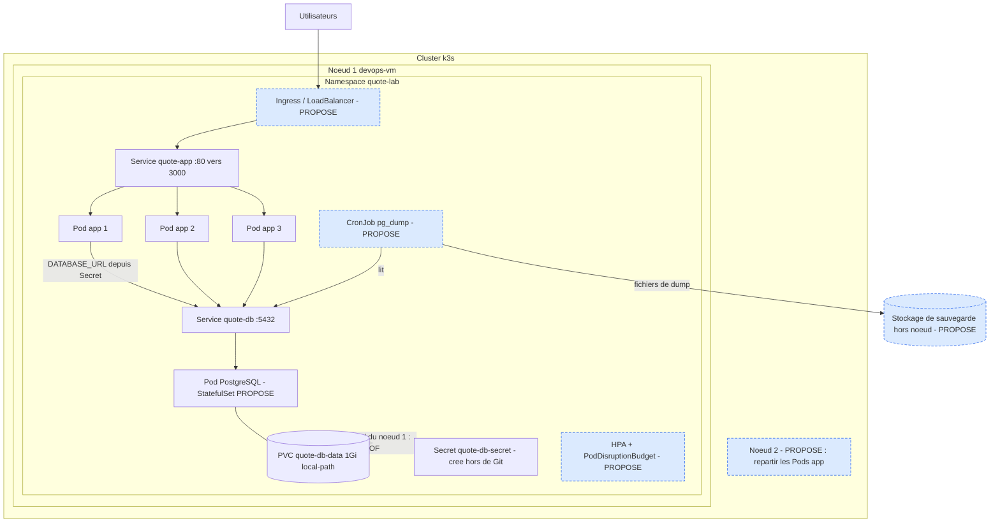

# Lab 62 – Architecture finale (Quote API)

Légende : **[Vérifié]** = réalisé et contrôlé dans mon lab Lab 52 (k3s, `devops-vm`, namespace `quote-lab`). **[Proposé]** = conception uniquement, non déployé.

# Current System Problems

Système d'origine (fictif) : un seul Pod qui fait tourner `quote-api` + PostgreSQL dans le même conteneur, données dans la couche inscriptible du conteneur, identifiants commités dans le manifeste, stratégie `Recreate`, ni probes ni limites, un seul nœud.

| # | Problème | Conséquence | Correctif proposé |
|---|---|---|---|
| 1 | PostgreSQL dans le même conteneur que l'app, données dans la couche inscriptible | Pod/conteneur remplacé = **toutes les données perdues** ; l'app et la base ne peuvent ni évoluer ni redémarrer séparément | Charge de travail séparée pour la base, avec son propre Service et un **PVC** (données hors du conteneur). *[Vérifié au Lab 52 : le marqueur a survécu au remplacement du Pod `quote-db`]* |
| 2 | Identifiants en valeurs littérales dans le manifeste commité | Toute personne ayant accès au dépôt connaît le mot de passe ; fuite via l'historique Git | **Secret** Kubernetes référencé via `secretKeyRef`/`secretRef`, créé hors de Git. *[Vérifié : `quote-db-secret`, jamais commité]* |
| 3 | Pod unique + stratégie `Recreate` | Chaque mise à jour ou crash = **coupure de service** ; aucune redondance | Deployment avec **3 replicas** et **RollingUpdate** (`maxUnavailable: 0`, `maxSurge: 1`). *[Vérifié : 3 replicas ; la stratégie RollingUpdate explicite est proposée]* |
| 4 | Pas de probes readiness/liveness | Du trafic envoyé vers des Pods cassés ; un process bloqué n'est jamais redémarré | `readinessProbe` + `livenessProbe` sur `/health`. *[Vérifié au Lab 42 : une probe en échec retire le Pod du Service / redémarre le conteneur]* |
| 5 | Pas de requests/limits de ressources | Un Pod (ou la base) peut affamer le nœud ; ordonnancement imprévisible ; OOM kills | Définir `requests`/`limits` sur l'app et la base ; ajouter un HPA ensuite. *[Proposé]* |
| 6 | Un seul nœud et un seul disque, pas de sauvegarde/restauration testée | Perte de la VM ou du disque = **perte totale et irrécupérable** des données | `pg_dump` planifié vers un stockage **hors du nœud**, avec une restauration **testée**. *[Proposé]* |

# Production Architecture

## Diagramme

Bleu/pointillés = **changements proposés**. Le reste a été déployé et vérifié au Lab 52.

## Composants

- **Deployment applicatif** `quote-app` *[Vérifié : 3 replicas, probes, `DATABASE_URL` depuis le Secret]*. *[Ajouts proposés]* : `strategy: RollingUpdate` (`maxUnavailable: 0`, `maxSurge: 1`), requests/limits de ressources, `topologySpreadConstraints` pour répartir sur plusieurs nœuds.
- **Service** `quote-app` (ClusterIP, 80 → 3000) *[Vérifié]*, exposé aux utilisateurs par un **Ingress** *[Proposé]*. Au Lab 52, j'ai seulement utilisé `port-forward`, qui cible un seul Pod et ne démontre pas le load balancing.
- **PostgreSQL** avec stockage persistant : Service `quote-db`, PVC `quote-db-data` (1Gi, RWO, `local-path`) *[Vérifié]*. Actuellement un Deployment en `Recreate` (1 replica). *[Proposé]* : passer à un **StatefulSet** (identité stable, `volumeClaimTemplates`) avec requests/limits.
- **Secrets** : le Secret est créé hors de Git (`kubectl create secret generic quote-db-secret ...`) et seulement référencé dans les manifestes *[Vérifié]*. *[Proposé en production]* : Sealed Secrets ou External Secrets pour provisionner les identifiants de façon reproductible sans les commiter en clair.
- **Sauvegarde/restauration** *[Proposé]* : un CronJob lance `pg_dump` (par ex. chaque nuit) et envoie le résultat vers un **stockage hors du nœud**. Une restauration dans un PostgreSQL neuf est testée régulièrement (une sauvegarde jamais restaurée n'est pas une sauvegarde).

## Frontières de panne

| Panne | Ce qui se passe | Récupération |
|---|---|---|
| **Pod de l'app tombe** | Le ReplicaSet le recrée ; la readiness le retire du Service entre-temps ; les 2 autres replicas continuent de servir *[Vérifié au Lab 42]* | Automatique, aucun impact sur les données |
| **Pod de la base tombe** | Le contrôleur le recrée et rattache le même PVC ; données conservées *[Vérifié : le marqueur a survécu]* ; base indisponible pendant le remplacement (1 replica, `Recreate`) | Automatique, courte indisponibilité de la base |
| **VM / nœud perdu** | Les Pods de l'app ne sont replanifiés **que s'il existe un autre nœud**. Avec un seul nœud, tout est arrêté. | Reconstruire l'infrastructure, redéployer les manifestes |
| **Disque perdu** | Le PVC `local-path` n'est qu'un dossier sur le disque de la VM : aucune réplication. **Un PVC n'est pas une sauvegarde.** | **Restaurer depuis le `pg_dump` hors nœud** ; les données postérieures à la dernière sauvegarde sont perdues (RPO = intervalle de sauvegarde) |

Distinction clé : la **disponibilité** (replicas, contrôleurs, probes) garde le service actif lors d'une panne de Pod ; la **récupération des données** (sauvegardes, restauration) est nécessaire en cas de perte du nœud ou du disque. Trois replicas sur un seul nœud ne suppriment pas la dépendance à ce nœud.

# Operational Strategy

- **Scalabilité** : l'app est sans état, donc on ajoute des replicas (`kubectl scale`) ou un **HPA** sur le CPU *[Proposé]* ; les requests/limits sont nécessaires pour que le HPA fonctionne. Le premier goulot d'étranglement est l'instance PostgreSQL unique, pas l'app.
- **Mises à jour sûres** : `RollingUpdate` avec `maxUnavailable: 0` ; les nouveaux Pods doivent passer la readiness avant que les anciens soient retirés. Vérification avec `kubectl rollout status`, les événements et `/health`. Retour arrière avec `kubectl rollout undo deployment/quote-app`. Le rollback d'un Deployment restaure seulement le **template de Pod (image/config)** ; il ne **restaure pas le contenu de la base** et n'**annule pas une migration de schéma**, car les données vivent dans le PVC. Les migrations doivent donc être rétrocompatibles (ajouter avant de supprimer), avec une sauvegarde faite avant. Règle de décision : mauvais code applicatif → rollback de l'app ; données corrompues ou perdues → restauration depuis la sauvegarde.
- **Détection des pannes** : readiness probe (arrêter d'envoyer du trafic aux Pods non prêts), liveness probe (redémarrer les conteneurs bloqués), readiness `pg_isready` sur PostgreSQL *[Vérifié]*. Lacunes : `/health` renvoie seulement `{ ok: true }` et ne teste pas la base ; pas encore de métriques ni d'alertes *[Proposé]* : alertes Prometheus sur les redémarrages, la readiness, les erreurs 5xx, la saturation de la base et l'échec du job de sauvegarde.
- **Contrôleurs de récupération** : ReplicaSet/Deployment recréent les Pods de l'app ; le contrôleur de la base recrée le Pod de la base ; le kubelet redémarre les conteneurs en cas d'échec de liveness ; un PodDisruptionBudget limite les interruptions volontaires *[Proposé]*. **Non couvert par les contrôleurs** : perte du nœud ou du disque, corruption des données, mauvaises migrations, suppressions accidentelles → cela demande une sauvegarde/restauration et une récupération de l'infrastructure.
- **Note d'environnement** *[Vérifié]* : au Lab 52, l'horloge de la VM avait environ un mois de retard et a cassé TLS (échec du pull d'image, PVC resté `Pending`). La synchronisation de l'heure (NTP) doit être surveillée en production.

# Weakest Point

**L'instance PostgreSQL unique sur stockage local au nœud.** C'est elle qui casserait en premier sous stress : un seul primaire, un seul replica, sur un seul nœud ; la perte du nœud ou du disque entraîne une indisponibilité et la perte de tout ce qui suit la dernière sauvegarde, et avec 10× plus de trafic elle devient le goulot avant l'app.

Compromis : je garde une seule instance parce que c'est simple et peu coûteux à exploiter. Les alternatives (réplication en streaming de PostgreSQL via un opérateur comme CloudNativePG, ou stockage répliqué/réseau) améliorent la disponibilité et le RPO, mais ajoutent de la complexité, du coût et de la charge d'exploitation. Les sauvegardes réduisent le risque de perte de données, mais pas l'indisponibilité pendant la restauration.
